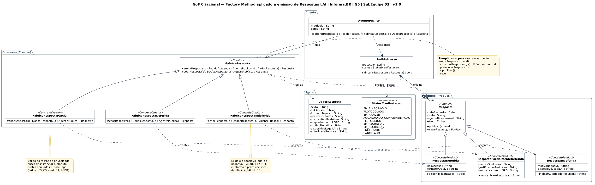
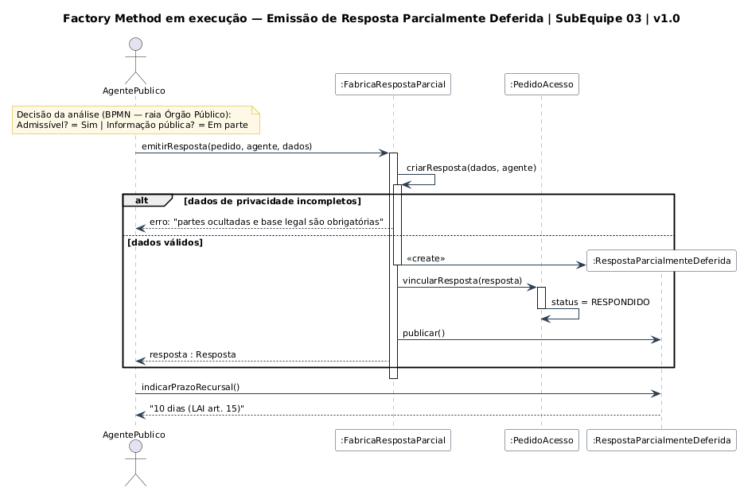

# Grupo 05 | Governo Eletrônico

**Código da Disciplina**: FGA0208<br>
**Número do Grupo**: 05<br>
**Entrega**: 03<br>

Repositório da **Entrega 03** da disciplina **Arquitetura e Desenho de Software (FGA0208)**. O projeto aborda a aplicação de **Padrões de Projeto** em um sistema de governo eletrônico inspirado no portal Informa.BR e na Lei de Acesso à Informação.

A documentação do projeto está disponível no [GitPages](https://unbarqdsw2026-2-turma02.github.io/2026.2-T02-_G5_ProjetoGovernoEletronico_Entrega_03/).

## Alunos

| Matrícula | Aluno |
| --- | --- |
| 211031735 | Isaac Lucas Souza Bezerra |
| | André João Cordeiro Gomes |
| | Rivadalvio Joaquim da Silva Filho |
| 202023805 | João Paulo Barros |

## Sobre

Este repositório contém os artefatos da **Entrega 03** da disciplina **Arquitetura e Desenho de Software (FGA0208)**. O tema da entrega são os **Padrões de Projeto GoF** (*Gang of Four*).

O objeto de estudo continua sendo o portal **Informa.BR** (informabr.cgu.gov.br), plataforma de busca de informações públicas e de pedidos de acesso à informação com base na **Lei de Acesso à Informação (LAI)**. As ênfases do projeto G5 continuam as mesmas: **privacidade de dados** e **usabilidade/experiência do usuário**.

Nesta entrega, cada padrão nasce de um **problema real identificado nas entregas anteriores**:

- **Entrega 01:** Rich Pictures, SIGs (NFR Framework), engenharia reversa e BPMN.
- **Entrega 02:** diagramas UML de Componentes, Sequência, Pacotes, Atividades, Classes e Máquina de Estados.

Cada padrão é registrado com:

- o **problema de projeto** que motivou a escolha;
- a **modelagem UML** do padrão aplicado ao domínio (estática e, quando útil, dinâmica);
- uma **implementação** em código executável;
- a **rastreabilidade** com os artefatos anteriores;
- o **senso crítico** sobre ganhos, custos e alternativas consideradas.

## Padrões de Projeto da Entrega 03

| SubEquipe | Família GoF | Padrão | Onde foi aplicado no Informa.BR |
| --- | --- | --- | --- |
| 03 | Criacional | **Factory Method** | Emissão das respostas a um Pedido de Acesso (Deferida, Parcialmente Deferida e Indeferida) |

### GoF Criacional: Factory Method (SubEquipe 03)



O padrão foi aplicado à hierarquia `Resposta` do Diagrama de Classes da Entrega 02:

- `FabricaResposta` define o processo de emissão, que é comum a todos os tipos: criar a resposta, vinculá-la ao pedido e publicar.
- O passo que muda, o *factory method* `criarResposta()`, fica em cada fábrica concreta.
- Cada fábrica valida as próprias regras da LAI e da LGPD. Exemplo: uma resposta parcialmente deferida só é criada se trouxer a parte ocultada e a base legal.



**Ficha Técnica — Factory Method:**
* **Autores:** SubEquipe 03 — Isaac Lucas, André João, Rivadalvio Joaquim e João Paulo Barros.
* **Fontes editáveis (PlantUML):** [Diagrama de Classes](docs/Base/Relatórios/Artefatos_SubEquipe_03/GoF_Criacional_FactoryMethod_V01.puml) · [Diagrama de Sequência](docs/Base/Relatórios/Artefatos_SubEquipe_03/GoF_Criacional_FactoryMethod_Sequencia_V01.puml)
* **Código:** [`codigo/subequipe-03/`](codigo/subequipe-03/) (TypeScript)

---

## Há algo a ser executado?

( ) NÃO

(X) SIM

Os padrões têm implementação executável. Para rodar a demonstração do **Factory Method** (SubEquipe 03), é preciso ter o **Node.js 18 ou superior**:

```bash
cd codigo/subequipe-03
npm install
npm start
```

A demonstração percorre quatro cenários e verifica cada um com `assert`:

1. resposta **deferida**;
2. resposta **parcialmente deferida**, com dados pessoais ocultados;
3. resposta **indeferida**, com fundamento legal;
4. tentativa de criar uma resposta parcial **sem base legal**, que a fábrica bloqueia. O pedido continua `EM_ANALISE`.

Saída esperada (resumo):

```text
[1] 50001.000001/2026-01 → Deferida | status=RESPONDIDO | cabe recurso? false
[2] 50001.000002/2026-02 → Parcialmente Deferida | prazo recursal: 10 dias a contar da ciência (LAI art. 15).
[3] 50001.000003/2026-03 → Indeferida | recurso: Autoridade hierarquicamente superior (1ª instância) — prazo de 10 dias (LAI art. 15).
[4] 50001.000004/2026-04 → criação barrada pela fábrica; status continua EM_ANALISE

Todos os cenários passaram ✔
```

<!-- TODO (SubEquipes 01 e 02): acrescentar as instruções de execução dos demais padrões. -->

## Informações Complementares

**Elos com as entregas anteriores:**

- [Entrega 01 — Desenho de Software (Base)](https://unbarqdsw2026-2-turma02.github.io/2026.2-T02-_G5_ProjetoGovernoEletronico_Entrega_01/)
- [Entrega 02 — Desenho de Software (Modelagem)](https://unbarqdsw2026-2-turma02.github.io/2026.2-T02-_G5_ProjetoGovernoEletronico_Entrega_02/)

**Referências gerais:**

- GAMMA, E.; HELM, R.; JOHNSON, R.; VLISSIDES, J. *Design Patterns: Elements of Reusable Object-Oriented Software*. Addison-Wesley, 1994.
- [Refactoring.Guru — Padrões de Projeto](https://refactoring.guru/pt-br/design-patterns)
- [Material da disciplina — Profa. Milene Serrano](https://sites.google.com/view/unb-fcte-arqdsw)
- [Lei de Acesso à Informação — Lei 12.527/2011](https://www.planalto.gov.br/ccivil_03/_ato2011-2014/2011/lei/l12527.htm)
- [Lei Geral de Proteção de Dados — Lei 13.709/2018](https://www.planalto.gov.br/ccivil_03/_ato2015-2018/2018/lei/l13709.htm)

#### Histórico de versões

| Versão | Data | Descrição | Autor(es) |
| :----: | :--: | :-------: | :-------: |
| 1.0 | 18/10/2026 | Criação do documento | João Paulo Barros |
| 1.1 | 19/10/2026 | Ajuste dos links dos artefatos e merge com a main | SubEquipe 03 |
