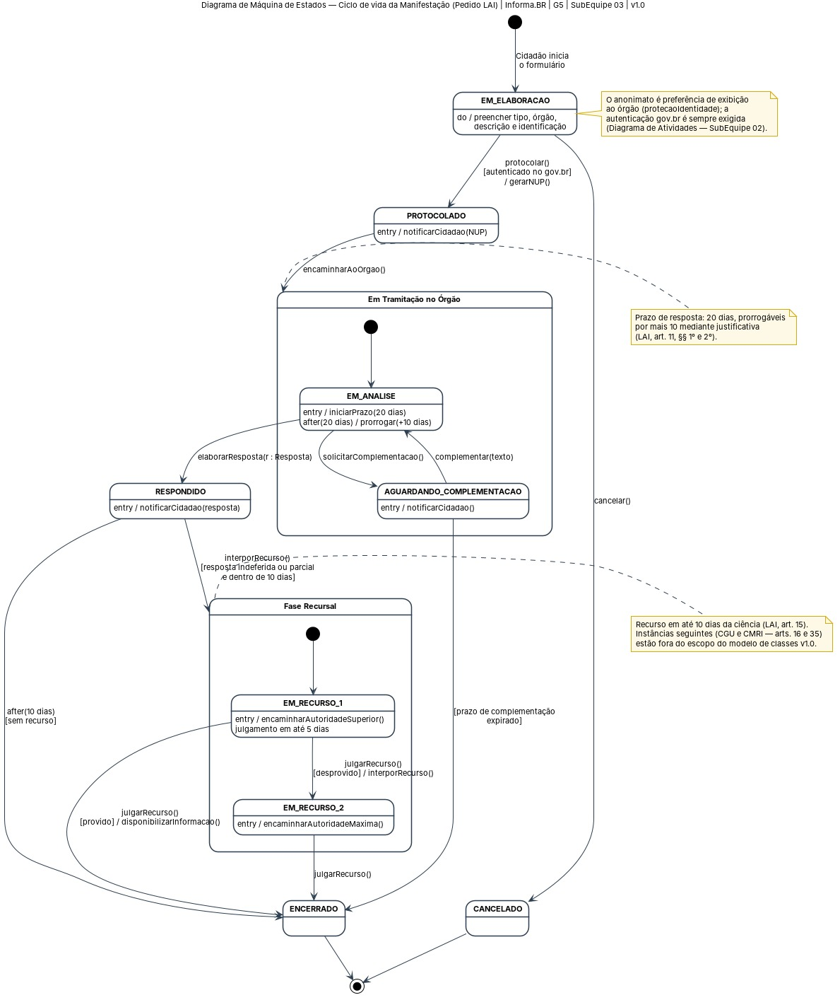
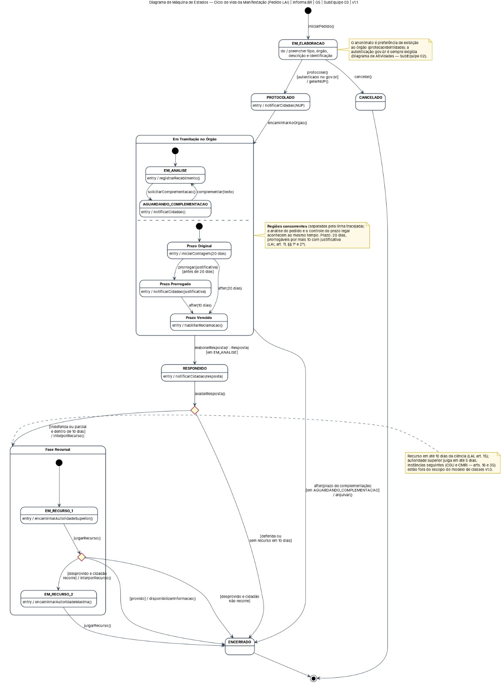
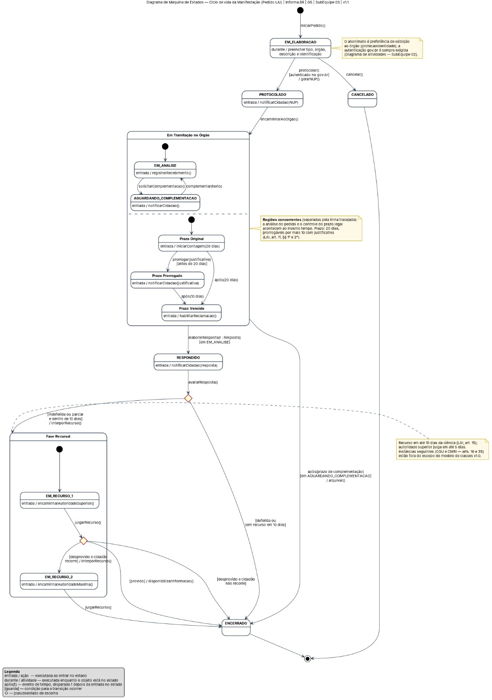

# 1.3. Iniciativas Extras (Padrões de Projeto)

Breve relato sobre as Iniciativas Extras realizadas pela equipe, no escopo da entrega.

## Iniciativa 01 — Revisão e correção da Entrega 02 a partir da avaliação da professora

| Item | Descrição |
| --- | --- |
| **Responsáveis** | SubEquipe 03 — Isaac Lucas, André João, João Paulo Barros e Rivadalvio Joaquim |
| **Período** | 18/10/2026 |
| **Motivação** | A avaliação da Entrega 02 classificou o modelo dinâmico da SubEquipe 03 como **"Média. Não é modelo de estados"**: o artefato publicado como *Diagrama de Estado* era, na verdade, um diagrama de processo em BPMN. |
| **Relação com a Entrega 03** | O Factory Method desta entrega usa a hierarquia `Resposta` e o enum `StatusManifestação` do Diagrama de Classes da Entrega 02. Corrigir o modelo dinâmico deixa a base de rastreabilidade do GoF consistente. |

### O que foi feito

**1. Modelo dinâmico da SubEquipe 03 refeito na notação UML**

O BPMN foi substituído por um **Diagrama de Máquina de Estados UML**, em duas versões:

- **v1.0:** estados iguais aos valores do enum `StatusManifestação`; transições com `evento [guarda] / ação`, usando os métodos do Diagrama de Classes; estados compostos; eventos de tempo com os prazos da LAI.
- **v1.1:** acrescenta os recursos que a avaliação apontou como ausentes, que são as **regiões concorrentes** (análise do pedido ∥ controle do prazo legal), os **pseudoestados de escolha** e as **transições pela borda dos estados compostos**.

**2. Atendimento ponto a ponto à avaliação**

| Ponto da avaliação | Como foi tratado |
| --- | --- |
| "Não é um diagrama de estados", notação UML não atendida | Refeito como Máquina de Estados UML (OMG UML 2.5.1, cap. 14) |
| Verbos (ações) no lugar de estados | Os estados são situações do objeto (`PROTOCOLADO`, `EM_ANALISE`…). Os verbos ficam só nos eventos e ações |
| Gateways, eventos e raias (elementos de BPMN) | Substituídos por **guardas** e **pseudoestados de escolha** |
| Início e fim como eventos de atividade | Pseudoestado inicial e estado final da UML |
| Abstrações refinadas e estados com compartilhamentos não usados | Estados compostos, **regiões concorrentes**, escolha, `após()`, `entrada /` e `durante /` (*entry* e *do* da UML) |
| Um único modelo | Evolução registrada: v0.1 (BPMN), v1.0 e v1.1 |
| Sem fontes | OMG UML 2.5.1, uml-diagrams.org, Booch et al. (*UML: Guia do Usuário*), PlantUML e LAI |

### Senso crítico

A avaliação mostrou que o grupo confundiu **comportamento de processo** (atividades, raias e decisões entre vários participantes) com **comportamento de estado** (as situações de um único objeto e os eventos que o fazem mudar). Refazer o modelo deixou mais claro para nós quando usar cada diagrama:

- **Diagrama de Atividades ou BPMN:** quando a pergunta é *"quem faz o quê, e em que ordem?"*.
- **Máquina de Estados:** quando a pergunta é *"em que situação está o pedido, e o que o faz mudar?"*.

O ponto que a correção do modelo **não resolve sozinha** é o rastro do trabalho em equipe. A avaliação indicou que "sabe-se apenas sobre o commit em coletivo". Por isso, esta iniciativa registra abaixo a ata da reunião e os artefatos da correção.

### Comprobatórios

| Evidência | Link |
| --- | --- |
| Ata da reunião de revisão | [Ata_Reuniao_01.md](Base/Relatórios/Artefatos_SubEquipe_03/Ata_Reuniao_01.md) |
| Relatório da SubEquipe 03 na Entrega 02 (artefato original corrigido por esta iniciativa) | [1.1.3.SubEquipe_03 (Entrega 02)](https://github.com/UnBArqDsw2026-2-Turma02/2026.2-T02-_G5_ProjetoGovernoEletronico_Entrega_02/blob/main/docs/Base/Relat%C3%B3rios/1.1.3.SubEquipe_03.md) |
| Diagramas de Máquina de Estados (v1.0, v1.1 e final) | [V1](https://unbarqdsw2026-2-turma02.github.io/2026.2-T02-_G5_ProjetoGovernoEletronico_Entrega_03/Base/Relat%C3%B3rios/Artefatos_SubEquipe_03/Correcao_Entrega2_V1.png) · [V2](https://unbarqdsw2026-2-turma02.github.io/2026.2-T02-_G5_ProjetoGovernoEletronico_Entrega_03/Base/Relat%C3%B3rios/Artefatos_SubEquipe_03/Correcao_Entrega2_V2.png) · [V3](https://unbarqdsw2026-2-turma02.github.io/2026.2-T02-_G5_ProjetoGovernoEletronico_Entrega_03/Base/Relat%C3%B3rios/Artefatos_SubEquipe_03/Correcao_Entrega2_V3.png) |
