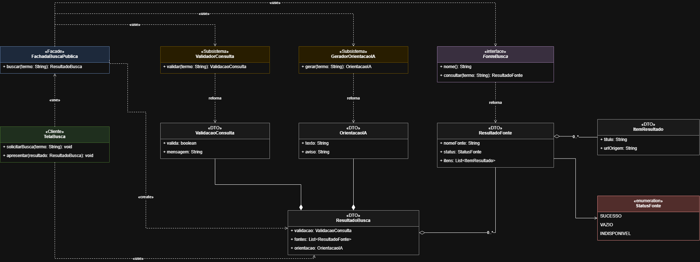
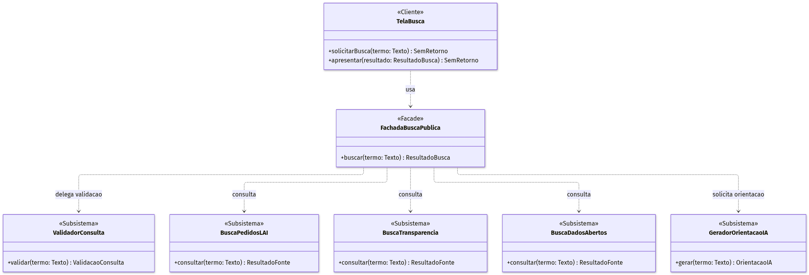

# SubEquipe_02
O relatório deverá conter a estrutura de focos estabelecida a seguir, bem como versionamentos, metodologia e participantes por foco.
Não omitir tópicos.

## Focos do Relatório:
### FOCO_02: GoFs Estruturais & IA Generativa
Entrega Mínima: um GoF Estrutural (modelo & código & vídeo com o padrão em execução).

---

## Registro de Alterações v2.0 (comparativo com v1.0)

### Resumo do que mudou e por quê

| # | Item | Em v1.0 (anterior) | Em v2.0 (esta versão) | Motivo da mudança |
| --- | --- | --- | --- | --- |
| 1 | Retorno de `FachadaBuscaPublica.buscar()` | `void` (apenas imprimia no console) | Retorna `ResultadoBusca` | O diagrama e o texto já previam a consolidação das respostas, mas o código não a implementava. Sem retorno, a fachada não consolidava nada. |
| 2 | Tipos de dados (DTOs) | Existiam só no diagrama (`ResultadoBusca`, `ResultadoFonte`, `ValidacaoConsulta`, `OrientacaoIA`) e foram omitidos no código | Implementados como `record` Java, mais `ItemResultado` e o enum `StatusFonte` | Eliminar a divergência entre modelo e código (rastreabilidade UML ↔ Java). |
| 3 | Validação do termo | `ValidadorConsulta.validar()` apenas imprimia a mensagem, e a fachada seguia mesmo com termo em branco | `validar()` retorna `ValidacaoConsulta`. A fachada interrompe o fluxo e **não consulta nenhuma fonte** se o termo for inválido | O texto afirmava rejeição precoce de termos em branco, e o código não fazia isso. |
| 4 | Falha de subsistema vs. busca vazia | Não implementado | Enum `StatusFonte` (`SUCESSO`, `VAZIO`, `INDISPONIVEL`). A fachada captura falhas por fonte e as demais continuam | Cumprir as decisões arquiteturais "Distinguir falha de busca vazia" e "falha de um subsistema não derruba os demais". |
| 5 | Subsistemas de busca | Três classes sem relação entre si, chamadas uma a uma pela fachada | Interface `FonteBusca` implementada por `BuscaPedidosLAI`, `BuscaTransparencia` e `BuscaDadosAbertos` | Reduz a duplicação na fachada (um laço em vez de três chamadas) e facilita incluir novas fontes. O ganho principal é a **extensibilidade**. |
| 6 | Instanciação na fachada | Campos com `new` direto | Construtor padrão (monta os subsistemas) **e** construtor com injeção | O cliente continua usando `new FachadaBuscaPublica()`, mas a fachada passa a ser testável com subsistemas substitutos. |
| 7 | Resposta da IA | Mensagem em console | `OrientacaoIA(texto, aviso)` separada dos dados oficiais, com o aviso de possíveis imprecisões | Reflete o painel "Resumo gerado por IA" observado no InformaBR e a decisão de segregar IA e dados oficiais. |
| 8 | Metadados e URLs de origem | Não representados | `ItemResultado(titulo, urlOrigem)` | Cumprir a decisão "Preservar metadados e URLs de origem". |
| 9 | `TelaBusca.apresentar()` | Sem parâmetros, imprimia "Busca simulada concluída." | `apresentar(ResultadoBusca)` exibe aviso de validação, resumo da IA e uma "aba" por fonte, com tratamento dos três status | A tela passa a **consumir** o resultado consolidado, como descrito no fluxo de colaboração. |
| 10 | Demonstração (`main`) | Uma busca ("educação") | Quatro buscas: normal, termo em branco, fonte indisponível e fonte sem registros | O vídeo pode mostrar todos os comportamentos do padrão. |
| 11 | Diagrama UML | v1.0 (preservado) | v2.0 (Mermaid abaixo, a exportar também para draw.io) | Acompanhar as mudanças 1 a 9. |
| 12 | Texto: "paralelamente" / "simultaneamente" | Texto sugeria execução paralela | Texto passa a dizer que a versão didática é **sequencial**, e o paralelismo fica como evolução possível | O código nunca foi paralelo, então o texto estava impreciso. |

### O que **não** foi alterado
- Contexto, evidências da observação do InformaBR, comparativo entre padrões GoF e critério decisivo.
- O papel dos participantes `TelaBusca` (Cliente) e `FachadaBuscaPublica` (Facade).

---

### Participantes no Foco_02
| Nome do Membro | Lições Aprendidas | Uso da IA Generativa (SENSO CRÍTICO) |
| --- | --- | --- |
| Fábio Alessandro | Com os feedbacks da professora, compreendi melhor como melhorar os passos seguintes do projeto, verificando se as decisões tomadas estão corretas. Além disso, percebi que os slides servem como um direcionamento inicial e que é necessário buscar estudos por fora para complementar e aprofundar os estudos. Essa experiência ampliou minha visão sobre o desenvolvimento de software, tanto pela perspectiva do usuário quanto da arquitetura do sistema como desenvolvedor. | Utilizei a IA como suporte em duas frentes: primeiro, para auxiliar na leitura e interpretação dos feedbacks da professora, obtendo sugestões de melhoria ([chat com a IA](https://claude.ai/share/9fcbcf39-4aae-4a7c-b9c2-dbfe7c817686)); em seguida, para sugerir caminhos de estudo e propor um padrão GoF Estrutural para o problema identificado ([chat com a IA](https://claude.ai/share/fb44780e-7d95-4e73-87cb-dc225a327b96)). No segundo momento, a IA tratou as soluções apenas como hipóteses e apresentou respostas que oscilavam muito em função da forma como a pergunta era formulada. Isso evidenciou a necessidade de senso crítico e intervenção do estudante para pesquisar, validar e tomar a decisão arquitetural definitiva. |
| Fábio Alessandro | Utilizei a IA também para verificação textual e suporte na documentação, percebendo que é de extrema importância que o artefato esteja claro tanto para a equipe técnica quanto para o público geral. | Utilizei a IA integrada (AntiGravity) para auxílio na revisão de escrita e clareza do texto. Pude observar que a IA é eficiente para correções pontuais, porém ocasionalmente alucina e sugere vocabulário rebuscado que não é comum no dia a dia. Portanto, na questão de acentuação e pontuação ela agrega bastante, mas exigiu filtro crítico contínuo para manter a objetividade técnica e a fidelidade aos requisitos da disciplina. |
| Pedro Augusto | Ao comparar o código com o diagrama e o texto, percebi que o código v1.0 não implementava o que o texto prometia (validação, consolidação, tratamento de falhas). Isso me fez perceber que é bem importante fazer algum tipo de verificação da coêrencia e consistência entre o modelo, o código e o que está sendo descrito. Também foi possivel perceber que sempre é possível melhorar o que foi feito com IA, porque ela sempre acaba indo muito além, e ai entra o senso critíco de quem está utilizando ela. | Usei a IA para revisar a coerência entre diagrama, código e texto e para propor a v2.0. Compilei e executei o código antes de aceitá-lo. Também fiz uma avaliação mais crítica a interface `FonteBusca`, porque é uma escolha de projeto, não uma exigência do Facade, e pode ser removida sem quebrar o padrão. Ainda com relação ao uso da IA, eu acredito que dessa vez a IA correspondeu bem ao que foi pedido com relação a geração de código, mas pecou na geração do diagrama UML, a imagem ficou muito ruim e toda distorcida, além de algumas alterações de conteúdo terem sido necessárias.  |

### Metodologia do Foco_02

Com a realização da primeira reunião da equipe e através de chats no WhatsApp, decidimos em conjunto qual padrão iria melhor se encaixar no nosso problema do InformaBR, decidimos também como vamos fazer a entrega e qual linguagem vamos utilizar.

**Metodologia da revisão v2.0:** a revisão partiu de uma checagem de rastreabilidade entre três artefatos (diagrama UML, código Java e texto do relatório). Cada afirmação do texto foi confrontada com o código. As divergências encontradas deram origem às mudanças listadas no Registro de Alterações.

### GoF Estrutural

#### Contexto (Problema)
A partir da análise do portal de governo eletrônico [InformaBR](https://informabr.cgu.gov.br/), observou-se o funcionamento da ferramenta de pesquisa na página inicial para propor a aplicação do padrão estrutural GoF Facade. O fluxo analisado foca na **Busca de Informações Públicas**, diferenciando-se da consulta pontual aos pedidos da Lei de Acesso à Informação (LAI).

Para a avaliação prática, foi realizada uma consulta com o termo *“educação”* no campo *“Descreva sua busca”*, sem necessidade de autenticação. A interface apresentou etapas de carregamento, um resumo preliminar gerado por IA e a consolidação de resultados categorizados por diferentes bases governamentais.

| Etapa | Evidência Observada |
| --- | --- |
| Entrada e envio | Campo de texto com envio do termo “educação” via tecla Enter. |
| Carregamento | Mensagens informativas: “Analisando sua pergunta......” e “Buscando pedidos de LAI...”. |
| Orientação por IA | Painel “Resumo gerado por IA”, contendo a interpretação da consulta, links sugeridos e aviso de possíveis imprecisões. |
| Resultados | Separação em abas: Pedidos LAI, Portal da Transparência e Portal de Dados Abertos. |
| Apresentação | Exibição de protocolos, sínteses de pedidos, registros de transparência, títulos e metadados de conjuntos de dados. |
| Continuação | Na aba Dados Abertos, a opção “Ver mais resultados” direciona para o portal de origem em nova aba, preservando o termo consultado. |

A consulta retornou resultados com sucesso, conforme observado na [página de busca do InformaBR](https://informabr.cgu.gov.br/busca-informacoes?termo=educa%C3%A7%C3%A3o).

#### Problema e Justificativa da Escolha
**Problema:** caso a interface com o usuário coordene diretamente a validação de parâmetros, as requisições a múltiplas fontes de dados e a geração do resumo por IA, ela se tornará fortemente acoplada a diversos subsistemas. Esse alto acoplamento compromete a manutenção e dificulta a evolução do fluxo de busca.

**Solução proposta:** introduzir a classe `FachadaBuscaPublica`, expondo uma operação unificada e simplificada. A fachada orquestra a validação, delega as consultas aos subsistemas especializados e consolida as respostas, mantendo a camada cliente desacoplada da complexidade interna.

Essa abordagem reflete a definição clássica do padrão Facade destacada nos [slides da disciplina](https://drive.google.com/file/d/1IVaP5dW-p44tUK2zlUXGwolabDy3d-eF/view): fornecer uma interface única e de alto nível que simplifica o acesso a um conjunto de interfaces em um subsistema complexo.

#### Comparativo de Padrões: Por que Facade?
A tabela a seguir compara o padrão Facade com outros padrões estruturais GoF ([com base nos slides da disciplina](https://drive.google.com/file/d/1IVaP5dW-p44tUK2zlUXGwolabDy3d-eF/view)), justificando sua escolha frente às características do problema identificado.

| Padrão | Propósito Central | Avaliação no Cenário da Busca |
| --- | --- | --- |
| **Facade** | Fornecer uma interface simplificada para um subsistema complexo. | **Escolhido:** a tela requer apenas uma operação unificada de busca, cabendo à fachada orquestrar validação, consultas e resumo por IA. |
| Adapter | Converter a interface de uma classe em outra interface esperada pelos clientes. | Embora possa ser útil na integração de uma API externa pontual, não resolve a coordenação do fluxo de busca como um todo. |
| Bridge | Desacoplar uma abstração de sua implementação para que ambas variem independentemente. | O cenário não apresenta múltiplos eixos de variação hierárquica que justifiquem essa separação. |
| Composite | Compor objetos em estruturas de árvore para representar hierarquias parte-todo. | As fontes de dados atuam como colaboradoras independentes, sem relação hierárquica recursiva. |
| Decorator | Agregar responsabilidades a um objeto de maneira dinâmica e flexível. | O foco reside na coordenação de serviços distintos, e não no empilhamento cumulativo de comportamentos. |
| Proxy | Controlar o acesso a um objeto por meio de um intermediário com a mesma interface. | Não há demanda central por controle de acesso, cache ou inicialização postergada de um objeto específico. |
| Flyweight | Compartilhar eficientemente grandes quantidades de objetos de granularidade fina. | O consumo de memória por excesso de instâncias compartilháveis não é o gargalo identificado neste recorte. |

**Critério decisivo:** a fachada centraliza uma operação completa, agregando e orquestrando múltiplos subsistemas em vez de atuar como mero repassador de chamadas.

#### Modelagem (Notação UML)

Para representar a arquitetura da solução, foi elaborado um diagrama de classes UML aderente à notação formal. Na modelagem:
- O modificador `+` indica visibilidade pública das operações da Fachada, do Cliente e dos Subsistemas.
- As setas tracejadas denotam dependências (`«use»` / delegação) entre o Cliente e a Fachada, e da Fachada em direção aos Subsistemas orquestrados, refletindo o acoplamento fraco preconizado pelo padrão GoF Facade.
- Os estereótipos (`«Cliente»`, `«Facade»`, `«Subsistema»`, «interface», «DTO» e «enumeration») definem formalmente os papéis exercidos por cada elemento no padrão.
- **[v2.0]** As estruturas de retorno (`ResultadoBusca`, `ResultadoFonte`, `ItemResultado`, `ValidacaoConsulta`, `OrientacaoIA` e o enum `StatusFonte`) são estereotipadas como `«DTO»` e **agora existem também no código** (ver Implementação). Elas não pertencem ao núcleo do padrão Facade, mas materializam a consolidação de respostas que a fachada realiza.
- **[v2.0]** A interface `FonteBusca` é implementada pelos três subsistemas de busca (setas de realização). A fachada depende da interface, e não de cada classe concreta de busca.

**Diagrama v2.0:**


**[Abrir Diagrama no draw.io (v2.0)](https://drive.google.com/file/d/1ASnmjEgjkd_2bDl8TdCa8-34dr7Qqwnz/view?usp=sharing)**
| **[Arquivo Fonte draw.io no Repositório (v2.0)](https://github.com/UnBArqDsw2026-2-Turma02/2026.2-T02-_G5_ProjetoGovernoEletronico_Entrega_03/blob/subequipe2/docs/Base/Relat%C3%B3rios/assets/diagrama_facade_v2.drawio)**

**Diagrama v1.0 (preservado para comparação):**


**[Abrir Diagrama no draw.io (v1.0)](https://drive.google.com/file/d/1X2MwLtBdzbfuB9xhogLyrG07TKX0xHJI/view?usp=sharing)**
| **[Arquivo Fonte draw.io no Repositório (v1.0)](https://github.com/UnBArqDsw2026-2-Turma02/2026.2-T02-_G5_ProjetoGovernoEletronico_Entrega_03/blob/subequipe2/docs/Base/Relat%C3%B3rios/assets/diagrama_facade.drawio)**

#### Participantes do Padrão e Responsabilidades

Esses participantes representam divisões lógicas de responsabilidade no software, sem implicar acoplamento por herança entre a fachada e os subsistemas.

> **Alterações na v2.0:** Incluídas a interface `FonteBusca` e as estruturas de dados, responsabilidades dos subsistemas ajustadas.

| Classe | Papel no Padrão | Responsabilidade Principal |
| --- | --- | --- |
| `TelaBusca` | Cliente | Capturar o termo informado pelo usuário, acionar a fachada e exibir o estado de carregamento, mensagens e os resultados consolidados (`ResultadoBusca`). |
| `FachadaBuscaPublica` | Facade | Centralizar a requisição, acionar os subsistemas necessários, isolar falhas individuais e agregar as respostas em uma estrutura unificada (`ResultadoBusca`). |
| `ValidadorConsulta` | Subsistema | Validar o termo de entrada antes do disparo das consultas, rejeitando entradas vazias ou em branco e retornando uma `ValidacaoConsulta`. |
| `FonteBusca` *(novo)* | Interface dos subsistemas de busca | Padronizar as fontes consultáveis (`nome()` e `consultar(termo)`), permitindo que a fachada as percorra sem conhecer cada classe concreta. |
| `BuscaPedidosLAI` | Subsistema (implementa `FonteBusca`) | Consultar e recuperar registros públicos associados à Lei de Acesso à Informação (LAI). |
| `BuscaTransparencia` | Subsistema (implementa `FonteBusca`) | Encapsular as consultas aos dados provenientes do Portal da Transparência. |
| `BuscaDadosAbertos` | Subsistema (implementa `FonteBusca`) | Recuperar conjuntos de dados abertos e seus respectivos links de referência. |
| `GeradorOrientacaoIA` | Subsistema | Gerar a síntese orientativa da consulta (`OrientacaoIA`), mantendo o conteúdo da IA delimitado e separado dos dados brutos. |
| `ResultadoBusca`, `ResultadoFonte`, `ItemResultado`, `ValidacaoConsulta`, `OrientacaoIA`, `StatusFonte` *(novo no código)* | Estruturas de dados (DTOs) | Transportar entre as camadas a validação, o resultado de cada fonte (com status e URLs de origem) e a orientação por IA. |

#### Colaboração entre as Classes

> **Alterações na v2.0:** Passos 2 a 7 reescritos para refletir o que o código realmente faz.

O fluxo de colaboração entre as classes ocorre nas seguintes etapas:

1. **Entrada e Disparo:** a `TelaBusca` recebe o termo do usuário, exibe o indicador visual de carregamento e chama a operação `buscar(termo)` da `FachadaBuscaPublica`.
2. **Validação Prévia:** a fachada aciona o `ValidadorConsulta`, que devolve uma `ValidacaoConsulta`. Caso o termo seja inválido, **a fachada interrompe o processo, não consulta nenhuma fonte** e retorna à tela um `ResultadoBusca` contendo a mensagem de validação.
3. **Consulta aos Subsistemas:** sendo o termo válido, a fachada percorre as `FonteBusca` (`BuscaPedidosLAI`, `BuscaTransparencia` e `BuscaDadosAbertos`) **sequencialmente** nesta versão didática. Cada consulta devolve um `ResultadoFonte` com status `SUCESSO` ou `VAZIO`. A execução concorrente é uma evolução possível, não implementada aqui.
4. **Geração de Síntese:** em seguida, a fachada solicita ao `GeradorOrientacaoIA` a elaboração do resumo temático (`OrientacaoIA`) com base no termo original.
5. **Consolidação:** a fachada unifica as respostas obtidas em um objeto `ResultadoBusca`, preservando a distinção entre dados oficiais das fontes e o texto gerado por IA.
6. **Tratamento de falhas:** se uma fonte lançar exceção, a fachada a captura, registra a fonte com status `INDISPONIVEL` e **segue consultando as demais**. Se a geração da orientação por IA falhar, o resultado carrega uma `OrientacaoIA` indisponível, sem perder as listas de resultados.
7. **Apresentação:** a `TelaBusca` renderiza o resumo da IA e uma seção por fonte, tratando de modo distinto `SUCESSO` (lista com links), `VAZIO` (nenhum registro encontrado) e `INDISPONIVEL` (fonte fora do ar).

#### Decisões Arquiteturais Propostas

> **Alterações na v2.0:** Acrescentadas as duas últimas linhas.

| Decisão Arquitetural | Justificativa no Domínio | Consequência / Limite |
| --- | --- | --- |
| Operação única `buscar()` na Fachada | Simplificar a interface para a tela cliente, desacoplando-a dos subsistemas. | A fachada absorve o conhecimento dos subsistemas, enquanto o cliente permanece protegido de mudanças internas. |
| Manter lógica específica nos subsistemas | Respeitar o princípio de responsabilidade única (SRP), pois cada fonte e a IA possuem regras próprias. | A fachada atua apenas como coordenadora, sem reter regras de negócio específicas de cada provedor. |
| Segregar a resposta da IA dos dados oficiais | Evitar que o resumo gerado por IA seja confundido com os registros públicos das fontes. | Contratos e modelos de dados mantêm estruturas distintas para o resumo e para as listas de resultados. |
| Preservar metadados e URLs de origem | Permitir que o cidadão valide e acesse diretamente os documentos originais. | O modelo de dados transporta links externos, delegando à interface a ação de abertura. |
| Validação prévia de parâmetros | Evitar o processamento e o consumo de rede desnecessários para termos em branco ou inválidos. | Reduz chamadas inúteis às APIs externas. |
| Distinguir falha de subsistema de busca vazia | Garantir transparência: uma fonte indisponível não deve passar a falsa impressão de inexistência de registros. | O objeto de resposta expõe o status individual de cada provedor consultado. |
| **[v2.0]** Interface `FonteBusca` para as fontes de dados | Permitir que a fachada trate as fontes de modo uniforme e isole falhas em um único ponto, sem repetir código por fonte. | É uma escolha de projeto que **vai além do núcleo do Facade**. Pode ser removida sem descaracterizar o padrão. Em contrapartida, aumenta o número de tipos. |
| **[v2.0]** Construtor com injeção de dependências, além do construtor padrão | Permitir testes da fachada com subsistemas substitutos, mantendo o uso simples pelo cliente. | O cliente continua sem conhecer os subsistemas. Quem precisar substituí-los usa o construtor completo. |

**Balanço Arquitetural:**
- **Benefício:** redução expressiva do acoplamento da interface cliente com as múltiplas APIs governamentais.
- **Custo:** inclusão de uma camada intermediária e definição de contratos formais de integração.
- **Risco a mitigar:** evitar que a fachada se torne um objeto inflado (*God Class*), garantindo que ela apenas coordene chamadas sem absorver regras analíticas ou lógica de apresentação. Em v2.0 a fachada contém apenas a sequência validar → consultar → orientar → consolidar, além do isolamento de falhas, e nenhuma regra específica de fonte.
- **Ponto de atenção (v2.0):** o cliente passa a depender dos tipos de dados (`ResultadoBusca` e correlatos), mas **continua sem depender de nenhum subsistema**. O acoplamento com os DTOs é aceitável, pois eles são o contrato público da fachada.
- **Mensagens de log (v2.0):** as classes imprimem mensagens no console apenas para acompanhar o fluxo na demonstração. Em um sistema real, isso seria feito por um mecanismo de log.

#### Implementação (Código & Vídeo com Padrão em Execução)

> **Alterações na v2.0:** Código reescrito. O código v1.0 está preservado no **Anexo A** (Final do arquivo).

O código-fonte modularizado em Java está versionado no repositório:
- **[Diretório de Código-Fonte do Padrão Facade](https://github.com/UnBArqDsw2026-2-Turma02/2026.2-T02-_G5_ProjetoGovernoEletronico_Entrega_03/tree/subequipe2/docs/Base/Relat%C3%B3rios/codigo)**


Arquivos da v2.0 (cada classe, interface, `record` ou `enum` em um arquivo `.java` com o mesmo nome):

| Arquivo | Papel | Status em relação à v1.0 |
| --- | --- | --- |
| `TelaBusca.java` | Cliente (`main`) | Alterado |
| `FachadaBuscaPublica.java` | Facade | Alterado |
| `ValidadorConsulta.java` | Subsistema de validação | Alterado |
| `FonteBusca.java` | Interface das fontes | **Novo** |
| `BuscaPedidosLAI.java` | Subsistema de consulta LAI | Alterado |
| `BuscaTransparencia.java` | Subsistema do Portal da Transparência | Alterado |
| `BuscaDadosAbertos.java` | Subsistema de Dados Abertos | Alterado |
| `GeradorOrientacaoIA.java` | Subsistema de orientação por IA | Alterado |
| `ResultadoBusca.java` | DTO | **Novo** |
| `ResultadoFonte.java` | DTO | **Novo** |
| `ItemResultado.java` | DTO | **Novo** |
| `ValidacaoConsulta.java` | DTO | **Novo** |
| `OrientacaoIA.java` | DTO | **Novo** |
| `StatusFonte.java` | Enum | **Novo** |

A implementação continua sendo uma **versão didática**: a busca é simulada e não acessa serviços reais. Os links exibidos são apenas as páginas iniciais dos portais, e não resultados reais. Requer **Java 17 ou superior** (uso de `record` e de `switch` com seta).

##### Estruturas de dados (DTOs)

```java
// StatusFonte.java
public enum StatusFonte {
    SUCESSO,
    VAZIO,
    INDISPONIVEL
}
```

```java
// ItemResultado.java
public record ItemResultado(String titulo, String urlOrigem) {
}
```

```java
// ResultadoFonte.java
import java.util.List;

public record ResultadoFonte(String nomeFonte, StatusFonte status, List<ItemResultado> itens) {

    public static ResultadoFonte de(String nomeFonte, List<ItemResultado> itens) {
        StatusFonte status = itens.isEmpty() ? StatusFonte.VAZIO : StatusFonte.SUCESSO;
        return new ResultadoFonte(nomeFonte, status, itens);
    }

    public static ResultadoFonte indisponivel(String nomeFonte) {
        return new ResultadoFonte(nomeFonte, StatusFonte.INDISPONIVEL, List.of());
    }
}
```

```java
// ValidacaoConsulta.java
public record ValidacaoConsulta(boolean valida, String mensagem) {
}
```

```java
// OrientacaoIA.java
public record OrientacaoIA(String texto, String aviso) {

    private static final String AVISO_PADRAO = "Resumo gerado por IA. Pode conter imprecisões.";

    public static OrientacaoIA gerada(String texto) {
        return new OrientacaoIA(texto, AVISO_PADRAO);
    }

    public static OrientacaoIA indisponivel() {
        return new OrientacaoIA("", "Orientação por IA indisponível no momento.");
    }

    public static OrientacaoIA vazia() {
        return new OrientacaoIA("", "");
    }
}
```

```java
// ResultadoBusca.java
import java.util.List;

public record ResultadoBusca(ValidacaoConsulta validacao,
                             List<ResultadoFonte> fontes,
                             OrientacaoIA orientacao) {

    public static ResultadoBusca invalida(ValidacaoConsulta validacao) {
        return new ResultadoBusca(validacao, List.of(), OrientacaoIA.vazia());
    }
}
```

##### Subsistemas

Os subsistemas encapsulam responsabilidades específicas do domínio. Nenhum deles conhece a fachada nem os demais subsistemas — cada um realiza apenas sua tarefa.

**`FonteBusca`** *(novo)* — contrato comum das fontes consultáveis.

```java
public interface FonteBusca {

    String nome();

    ResultadoFonte consultar(String termo);
}
```

**`ValidadorConsulta`** — verifica o termo de entrada e **retorna** o resultado da validação.

```java
public class ValidadorConsulta {

    public ValidacaoConsulta validar(String termo) {
        System.out.println("  [ValidadorConsulta] validando termo");
        if (termo == null || termo.isBlank()) {
            return new ValidacaoConsulta(false, "Informe um termo para realizar a busca.");
        }
        return new ValidacaoConsulta(true, "Consulta válida.");
    }
}
```

**`BuscaPedidosLAI`** — consulta registros públicos de pedidos feitos com base na Lei de Acesso à Informação.

```java
import java.util.List;

public class BuscaPedidosLAI implements FonteBusca {

    @Override
    public String nome() {
        return "Pedidos LAI";
    }

    @Override
    public ResultadoFonte consultar(String termo) {
        System.out.println("  [BuscaPedidosLAI] buscando pedidos LAI sobre: " + termo);
        return ResultadoFonte.de(nome(), List.of(
                new ItemResultado("Pedido LAI simulado nº 001 sobre " + termo,
                        "https://informabr.cgu.gov.br/"),
                new ItemResultado("Pedido LAI simulado nº 002 sobre " + termo,
                        "https://informabr.cgu.gov.br/")));
    }
}
```

**`BuscaTransparencia`** — recupera informações do Portal da Transparência. Para demonstrar o status `VAZIO`, o termo `inexistente` simula uma fonte disponível sem registros.

```java
import java.util.List;

public class BuscaTransparencia implements FonteBusca {

    @Override
    public String nome() {
        return "Portal da Transparência";
    }

    @Override
    public ResultadoFonte consultar(String termo) {
        System.out.println("  [BuscaTransparencia] buscando registros de transparência sobre: " + termo);
        // Simulação de "busca sem registros" (fonte disponível, porém sem resultados).
        if (termo.equalsIgnoreCase("inexistente")) {
            return ResultadoFonte.de(nome(), List.of());
        }
        return ResultadoFonte.de(nome(), List.of(
                new ItemResultado("Registro de transparência simulado sobre " + termo,
                        "https://portaldatransparencia.gov.br/")));
    }
}
```

**`BuscaDadosAbertos`** — busca conjuntos de dados abertos. Para demonstrar o status `INDISPONIVEL`, o termo `falha` simula uma queda do portal.

```java
import java.util.List;

public class BuscaDadosAbertos implements FonteBusca {

    @Override
    public String nome() {
        return "Portal de Dados Abertos";
    }

    @Override
    public ResultadoFonte consultar(String termo) {
        System.out.println("  [BuscaDadosAbertos] buscando conjuntos de dados sobre: " + termo);
        // Simulação de indisponibilidade da fonte (falha técnica, diferente de busca vazia).
        if (termo.equalsIgnoreCase("falha")) {
            throw new IllegalStateException("Portal de Dados Abertos fora do ar (simulado)");
        }
        return ResultadoFonte.de(nome(), List.of(
                new ItemResultado("Conjunto de dados simulado sobre " + termo,
                        "https://dados.gov.br/")));
    }
}
```

**`GeradorOrientacaoIA`** — gera a síntese orientativa da consulta, simulando o resumo produzido por IA.

```java
public class GeradorOrientacaoIA {

    public OrientacaoIA gerar(String termo) {
        System.out.println("  [GeradorOrientacaoIA] gerando orientação simulada sobre: " + termo);
        return OrientacaoIA.gerada("Simulação: a consulta \"" + termo
                + "\" parece buscar informações públicas relacionadas ao tema. "
                + "Consulte as abas de resultados para os registros oficiais.");
    }
}
```

##### Fachada

**`FachadaBuscaPublica`** é o ponto central do padrão. Expõe uma única operação pública (`buscar`), que valida, consulta as fontes, isola falhas, solicita a orientação por IA e **devolve um `ResultadoBusca` consolidado**. O construtor sem argumentos monta os subsistemas, de modo que o cliente não precisa conhecê-los. O construtor com argumentos permite substituí-los em testes.

```java
import java.util.ArrayList;
import java.util.List;

public class FachadaBuscaPublica {

    private final ValidadorConsulta validador;
    private final List<FonteBusca> fontes;
    private final GeradorOrientacaoIA orientacaoIA;

    public FachadaBuscaPublica() {
        this(new ValidadorConsulta(),
             List.of(new BuscaPedidosLAI(), new BuscaTransparencia(), new BuscaDadosAbertos()),
             new GeradorOrientacaoIA());
    }

    public FachadaBuscaPublica(ValidadorConsulta validador,
                               List<FonteBusca> fontes,
                               GeradorOrientacaoIA orientacaoIA) {
        this.validador = validador;
        this.fontes = fontes;
        this.orientacaoIA = orientacaoIA;
    }

    public ResultadoBusca buscar(String termo) {
        ValidacaoConsulta validacao = validador.validar(termo);
        if (!validacao.valida()) {
            return ResultadoBusca.invalida(validacao);
        }

        String termoLimpo = termo.strip();
        List<ResultadoFonte> resultados = new ArrayList<>();
        for (FonteBusca fonte : fontes) {
            try {
                resultados.add(fonte.consultar(termoLimpo));
            } catch (RuntimeException e) {
                System.out.println("  [Fachada] falha em '" + fonte.nome() + "': " + e.getMessage());
                resultados.add(ResultadoFonte.indisponivel(fonte.nome()));
            }
        }

        OrientacaoIA orientacao;
        try {
            orientacao = orientacaoIA.gerar(termoLimpo);
        } catch (RuntimeException e) {
            orientacao = OrientacaoIA.indisponivel();
        }

        return new ResultadoBusca(validacao, resultados, orientacao);
    }
}
```

##### Cliente

**`TelaBusca`** representa a camada de apresentação. Interage exclusivamente com a fachada: solicita a busca por `solicitarBusca` e exibe o `ResultadoBusca` recebido por meio de `apresentar`. O `main` executa quatro cenários: busca normal, termo em branco, fonte indisponível e fonte sem registros.

```java
public class TelaBusca {

    private final FachadaBuscaPublica fachada = new FachadaBuscaPublica();

    public void solicitarBusca(String termo) {
        System.out.println("\n=== Busca: \"" + termo + "\" ===");
        System.out.println("Analisando sua pergunta...");
        ResultadoBusca resultado = fachada.buscar(termo);
        apresentar(resultado);
    }

    public void apresentar(ResultadoBusca resultado) {
        if (!resultado.validacao().valida()) {
            System.out.println("Aviso: " + resultado.validacao().mensagem());
            return;
        }

        OrientacaoIA ia = resultado.orientacao();
        System.out.println("\n[Resumo gerado por IA]");
        if (!ia.texto().isBlank()) {
            System.out.println("  " + ia.texto());
        }
        System.out.println("  (" + ia.aviso() + ")");

        for (ResultadoFonte fonte : resultado.fontes()) {
            System.out.println("\n[Aba: " + fonte.nomeFonte() + "]");
            switch (fonte.status()) {
                case SUCESSO -> fonte.itens().forEach(item ->
                        System.out.println("  - " + item.titulo() + " -> " + item.urlOrigem()));
                case VAZIO -> System.out.println("  Nenhum registro encontrado para esta fonte.");
                case INDISPONIVEL -> System.out.println("  Fonte indisponível no momento. Tente novamente mais tarde.");
            }
        }
        System.out.println("\nBusca simulada concluída.");
    }

    public static void main(String[] args) {
        TelaBusca tela = new TelaBusca();
        tela.solicitarBusca("educação");     // fluxo normal
        tela.solicitarBusca("   ");          // termo em branco (validação)
        tela.solicitarBusca("falha");        // uma fonte indisponível
        tela.solicitarBusca("inexistente");  // uma fonte sem registros
    }
}
```

##### Saída esperada da execução (verificada em Java 21)

Trecho dos três cenários que diferem do fluxo normal:

```text
=== Busca: "   " ===
Analisando sua pergunta...
  [ValidadorConsulta] validando termo
Aviso: Informe um termo para realizar a busca.
```

```text
=== Busca: "falha" ===
  ...
  [BuscaDadosAbertos] buscando conjuntos de dados sobre: falha
  [Fachada] falha em 'Portal de Dados Abertos': Portal de Dados Abertos fora do ar (simulado)
  [GeradorOrientacaoIA] gerando orientação simulada sobre: falha
  ...
[Aba: Pedidos LAI]
  - Pedido LAI simulado nº 001 sobre falha -> https://informabr.cgu.gov.br/
  ...
[Aba: Portal de Dados Abertos]
  Fonte indisponível no momento. Tente novamente mais tarde.
```

```text
=== Busca: "inexistente" ===
  ...
[Aba: Portal da Transparência]
  Nenhum registro encontrado para esta fonte.
```

No cenário `falha`, as demais abas continuam exibindo seus resultados, e a fonte indisponível é distinguida de uma busca vazia.

A saída completa dos quatro cenários está no README.md do diretório codigo.

##### Nota sobre simplificações e rastreabilidade com a Modelagem UML

> **Alterações na v2.0:** A nota da v1.0 (que justificava a omissão dos DTOs) foi substituída.

1. **Rastreabilidade UML ↔ código:** todas as classes do diagrama v2.0 existem no código com o mesmo nome e as mesmas operações. Os DTOs são implementados como `record` (e `StatusFonte` como `enum`).
2. **Simulação:** continuam simulados o acesso aos serviços reais, o conteúdo dos resultados e o texto da IA. Os termos `falha` e `inexistente` existem apenas para demonstrar os status `INDISPONIVEL` e `VAZIO`.
3. **Execução sequencial:** as fontes são consultadas uma após a outra. Paralelizá-las seria uma evolução independente do padrão.
4. **Preservação da estrutura GoF:** o cliente (`TelaBusca`) depende exclusivamente da fachada e dos tipos de dados que ela devolve. A fachada coordena os subsistemas (`ValidadorConsulta`, `FonteBusca` e suas implementações, `GeradorOrientacaoIA`), e os subsistemas não conhecem a fachada nem o cliente.
5. **Limitação conhecida:** o cliente instancia a fachada diretamente (`new FachadaBuscaPublica()`). Em um sistema real, ela poderia ser fornecida por injeção de dependências.

---

## Versionamentos
| Nome do Membro | Contribuição | Data |
| --- | --- | --- |
| Fábio Alessandro | Elaboração completa da primeira versão do trabalho (v1.0) | 18/10/2026 |
| Pedro Augusto | Elaboração completa da segunda versão do trabalho (v2.0): verificação de rastreabilidade entre diagrama, código e texto, implementação dos DTOs, do isolamento de falhas por fonte e da interface `FonteBusca`, novo diagrama UML, atualização dos trechos do texto afetados, versão v1.0 preservada (Anexo A). | 18/10/2026 |
| Fábio Alessandro | Inclusão do link do vídeo de demonstração da execução da v1.0 no Anexo A | 19/10/2026 |

OBS: TODOS DEVEM PARTICIPAR, MOSTRANDO SEUS PONTOS DE VISTA E COMO COLABORARAM NA ENTREGA.

## Referências
As referências a seguir fundamentam os conceitos e decisões abordados neste relatório:

1. **SERRANO, Milene. Arquitetura e Desenho de Software — Aula GoFs Estruturais.** Pp. 7–8: objetivos resumidos dos padrões estruturais; p. 61: modelagem; p. 62: leitura complementar. [Slides](https://drive.google.com/file/d/1IVaP5dW-p44tUK2zlUXGwolabDy3d-eF/view). Consulta: 18/10/2026.
2. **SERRANO, Milene. GoFs Estruturais — página da aula.** Seções Aula e Materiais de Consulta. [Página da disciplina](https://sites.google.com/view/unb-fcte-arqdsw/m%C3%B3dulos/m%C3%B3dulo-padr%C3%A3o-de-projeto/gofs-estruturais). Consulta: 18/10/2026.
3. **Wiki — Diretrizes 2026.2 — T02 — 10hrs.** Pp. 9–11: padrões de projeto, entrega mínima, rastreabilidade e participações. [Documento de Diretrizes](https://drive.google.com/file/d/1WVeN2_QvxYZ82PwApWeAXfxVzKd_OpSK/view). Consulta: 18/10/2026.
4. **SERRANO, Milene. IA Generativa (Reflexão).** Orientações sobre autoria do relatório e uso de IA. [Página](https://sites.google.com/view/unb-fcte-arqdsw/ia-generativa-reflex%C3%A3o). Consulta: 18/10/2026.
5. **CONTROLADORIA-GERAL DA UNIÃO. Informa.BR — Busca de Informações Públicas.** Observação direta da consulta “educação”. [Busca observada](https://informabr.cgu.gov.br/busca-informacoes?termo=educa%C3%A7%C3%A3o). Consulta: 18/10/2026.

---

## Anexo A — Versão anterior preservada (v1.0): código e nota de simplificações

> Conteúdo mantido sem alterações, para comparação com a v2.0.

- **Vídeo com o Padrão em Execução (Entrega v1.0):** [Assistir ao vídeo da v1.0 (Google Drive)](https://drive.google.com/file/d/1GrMGErDdUaJwat6AnoHkzeLS4aRw2XbU/view?usp=sharing)

### Subsistemas (v1.0)

```java
public class ValidadorConsulta {

    public void validar(String termo) {
        System.out.println("Validando consulta: " + termo);
    }
}
```

```java
public class BuscaPedidosLAI {

    public void consultar(String termo) {
        System.out.println("Buscando pedidos LAI sobre: " + termo);
    }
}
```

```java
public class BuscaTransparencia {

    public void consultar(String termo) {
        System.out.println("Buscando informações de transparência sobre: " + termo);
    }
}
```

```java
public class BuscaDadosAbertos {

    public void consultar(String termo) {
        System.out.println("Buscando dados abertos sobre: " + termo);
    }
}
```

```java
public class GeradorOrientacaoIA {

    public void gerar(String termo) {
        System.out.println("Gerando orientação simulada sobre: " + termo);
    }
}
```

### Fachada (v1.0)

```java
public class FachadaBuscaPublica {

    private ValidadorConsulta validador = new ValidadorConsulta();
    private BuscaPedidosLAI pedidosLAI = new BuscaPedidosLAI();
    private BuscaTransparencia transparencia = new BuscaTransparencia();
    private BuscaDadosAbertos dadosAbertos = new BuscaDadosAbertos();
    private GeradorOrientacaoIA orientacaoIA = new GeradorOrientacaoIA();

    public void buscar(String termo) {
        validador.validar(termo);
        pedidosLAI.consultar(termo);
        transparencia.consultar(termo);
        dadosAbertos.consultar(termo);
        orientacaoIA.gerar(termo);
    }
}
```

### Cliente (v1.0)

```java
public class TelaBusca {

    private FachadaBuscaPublica fachada = new FachadaBuscaPublica();

    public void solicitarBusca(String termo) {
        fachada.buscar(termo);
        apresentar();
    }

    public void apresentar() {
        System.out.println("Busca simulada concluída.");
    }

    public static void main(String[] args) {
        TelaBusca tela = new TelaBusca();
        tela.solicitarBusca("educação");
    }
}
```

### Nota sobre simplificações e rastreabilidade com a Modelagem UML (v1.0)

Para fins didáticos e demonstração do comportamento orquestrador do padrão Facade:
1. **Omissão dos tipos conceituais (`ResultadoBusca`, `ResultadoFonte`, `ValidacaoConsulta` e `OrientacaoIA`):** No diagrama de classes arquitetural, esses tipos foram modelados como representações formais de transferência de dados (DTOs). Na implementação em código Java, eles foram propositalmente omitidos e substituídos por retornos `void` e mensagens de log no console. Essa escolha evita o excesso de classes utilitárias de dados e mantém o foco estritamente na mecânica de colaboração e desacoplamento do padrão Facade.
2. **Operações de validação e apresentação:** O método `validar()` executa uma confirmação simulada em console, e o método `apresentar()` não recebe parâmetros adicionais.
3. **Preservação da estrutura GoF:** Toda a dinâmica essencial do padrão foi rigorosamente preservada: o cliente (`TelaBusca`) depende exclusivamente da Fachada (`FachadaBuscaPublica`), e esta coordena e instancia internamente os múltiplos subsistemas (`ValidadorConsulta`, `BuscaPedidosLAI`, `BuscaTransparencia`, `BuscaDadosAbertos` e `GeradorOrientacaoIA`), sem que os subsistemas conheçam a Fachada ou o Cliente.