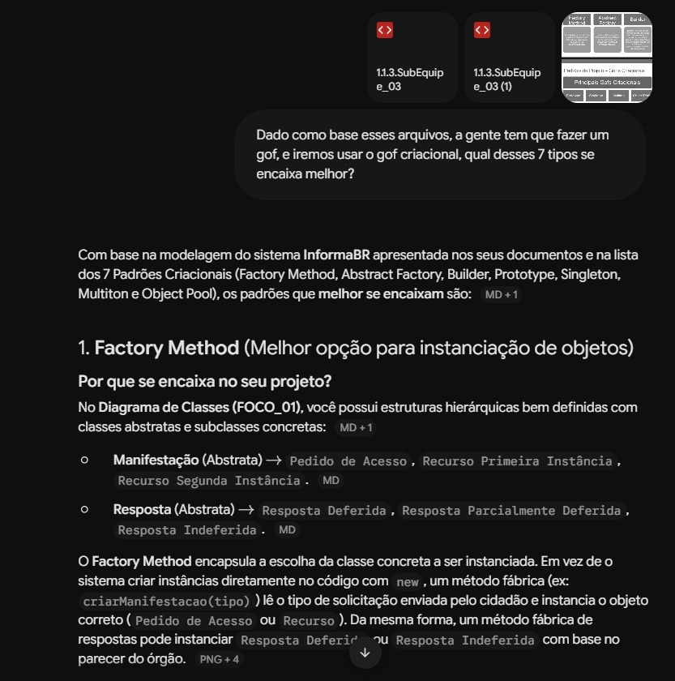
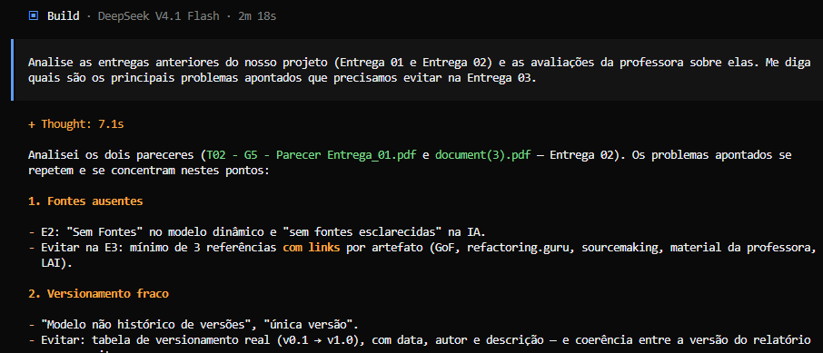
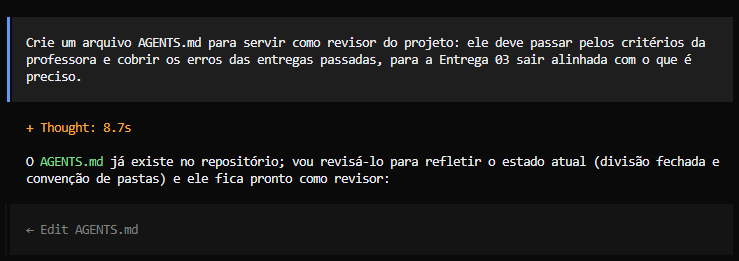
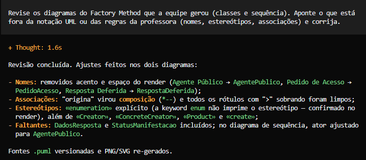
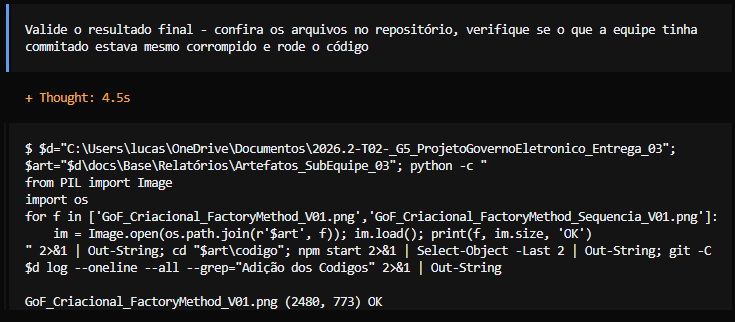
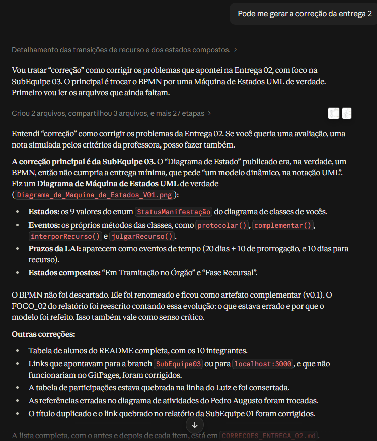
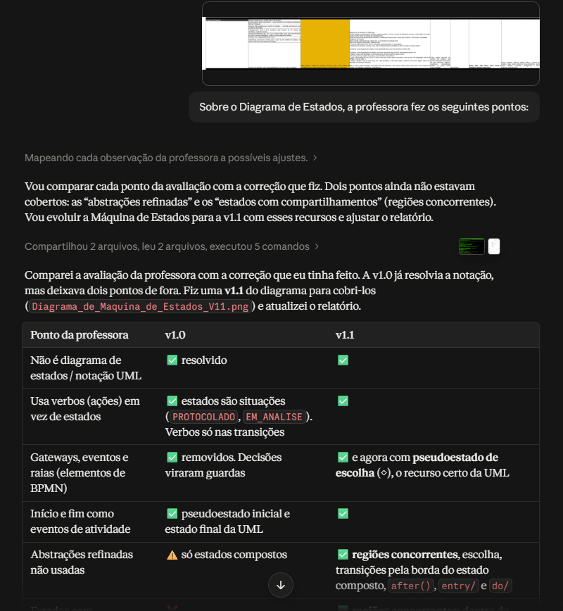
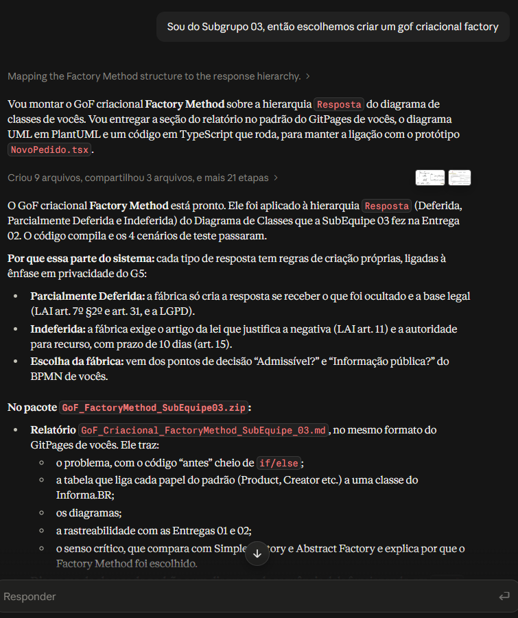
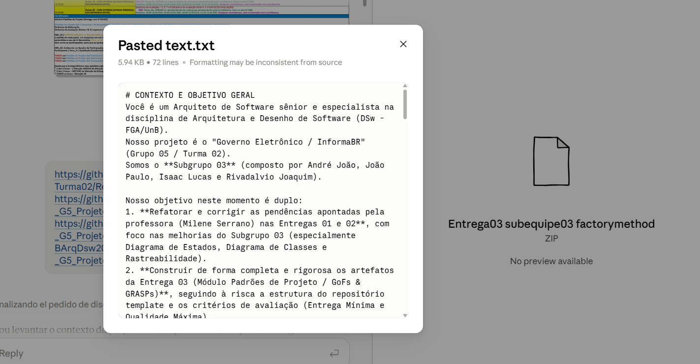

# SubEquipe_03
O relatório deverá conter a estrutura de focos estabelecida a seguir, bem como versionamentos, metodologia e participantes por foco.
Não omitir tópicos.

## Focos do Relatório:
### FOCO_01: GoFs Criacionais & IA Generativa
Entrega Mínima: um GoF Criacional (modelo & código & vídeo com o padrão em execução).

> **Observação:** a SubEquipe 03 ficou responsável pelos **GoFs Criacionais** e o padrão escolhido foi o **Factory Method**, aplicado à hierarquia `Resposta` do domínio do Informa.BR/LAI.

### Participantes no Foco_01
| Nome do Membro | Lições Aprendidas | Uso da IA Generativa (SENSO CRÍTICO) |
| --- | --- | --- |
| Isaac Lucas | Aprendi a diferença entre o Factory Method e o Simple Factory, que é uma fábrica simples cheia de condições para decidir o que criar. No começo, o Abstract Factory parecia uma boa escolha, mas vimos que ele serve para criar famílias de objetos e, como no nosso caso cada decisão gera um único produto, o Factory Method se encaixou melhor no domínio. | Usei a IA mapeando as entregas passadas, também a avaliação da professora sobre nossos erros e para entender quais os principais problemas. Usei um AGENTS.md para servir como esse revisor, onde vai passar por vários dos critérios a ponto da entrega ser alinhada com o que é preciso, mas não substituindo completamente a revisão humana. Usei também para ajudar na revisão dos diagramas gerados pelos membros da equipe. No fim, ajudou a deixar a entrega mais organizada e completa. |
| André João | Dentro da pesquisa a respeito de qual GoF Criacional a gente utilizaria, o que mais me pareceu condizer com o projeto foi o criacional abstract. | Utilizei a IA para verificar se o meu entendimento a respeito do melhor GoF a usar, se era o [abstract](Artefatos_SubEquipe_03/evidencias-ia/andre/pesquisaIA.jpeg) mesmo, ou então algum outro. |
| João Paulo Barros | Sobre os GoFs, eu entendi que ele vai atinger o problema e não o padrão. Quando fui revisar o Diagrama de Classes da Entrega 02 com a equipe, deu para ver que a hierarquia `Resposta` (Deferida, Parcialmente Deferida e Indeferida) tinha um problema claro de criação: cada tipo exige regras próprias. O Factory Method delega a uma subclasse a decisão de qual objeto criar. O Abstract Factory cria *famílias* de objetos relacionados. Como cada decisão do órgão gera um único produto, o Factory Method resolve com menos complexidade, e o Abstract Factory passa a fazer sentido se cada resposta também tiver de gerar a notificação e o comprovante do mesmo tipo. Também entendi a diferenciar as notações, por exemplo, nomes de associação ficam no presente ("usa", "produz"), operações e mensagens ficam no infinitivo (`criarResposta()`), e `«create»` é estereótipo, não verbo. | Usei a IA generativa (Claude) em três frentes: (1) analisar os artefatos das Entregas 01 e 02 e levantar onde cada GoF se encaixaria no Informa.BR; (2) gerar o primeiro rascunho do modelo em PlantUML, do código e do relatório do Factory Method; (3) revisar a Entrega 02, o que revelou que o nosso "Diagrama de Estado" era na verdade um BPMN. A IA acelerou o trabalho, mas claro que eu precisei conferir o resultado: a primeira renderização da Máquina de Estados colocou estados fora dos estados compostos; o código foi gerado em TypeScript, enquanto o nosso planejamento previa Python; e o diagrama usava nomes com acento e espaço, contra a convenção definida pela subequipe. |
| Rivadalvio Joaquim | Aprendi que um padrão criacional só se justifica quando existe um problema real de criação no domínio. No Factory Method, a separação entre o processo comum (emitirResposta(), que valida, vincula a resposta ao pedido e publica) e o único passo que varia (criarResposta()) deixa as regras da LAI de cada tipo de resposta em um lugar só. Isso ficou evidente no teste do Princípio Aberto/Fechado: uma fábrica nova de "Informação Inexistente" funcionou sem alterar nenhuma linha do código existente. Também aprendi a diferenciar transição interna de autotransição na Máquina de Estados: uma autotransição reexecuta o entry e, no nosso caso, reiniciaria a contagem do prazo. | Usei a IA (Claude) para gerar o código, os testes e os diagramas renderizados. Precisei corrigir a IA em vários pontos. Ela propôs o padrão Builder, que eu recusei porque o grupo já tinha escolhido o Factory Method sobre a hierarquia Resposta. O nosso rascunho citava código e imagens que ainda não existiam no repositório, e só percebemos ao conferir. Por fim, conferi os artigos da LAI e do Decreto 7.724/2012 citados no texto oficial do Planalto, em vez de aceitar a citação da IA. A conclusão é que a IA acelera muito a produção, mas sem revisão humana ela entrega um resultado bem-acabado e com erros. |

#### Evidências de uso da IA Generativa

Cada membro registra suas próprias evidências de uso da IA Generativa:

**André João** — pesquisa com a IA sobre qual dos GoFs Criacionais se encaixa melhor no projeto:



**Isaac Lucas** — sessão da IA (opencode) usada para mapear os problemas das Entregas 01 e 02, criar o revisor do projeto (AGENTS.md), revisar os diagramas e validar a execução do código:

**1. Mapeamento dos problemas das Entregas 01 e 02 (e da avaliação da professora)**



**2. Criação do AGENTS.md como revisor do projeto**



**3. Revisão dos diagramas do Factory Method**



**4. Validação final (arquivos, corrupção e execução do código)**



**João Paulo Barros** — sessão da IA Generativa (Claude) usada para contextualizar o projeto, apoiar a correção da Entrega 02, corrigir o UML com os apontamentos da professora e prever o GoF, com comprovação em vídeo:








- **Comprobatório em vídeo:** [vídeo no YouTube](https://youtube.com/shorts/yN_OuSJmWxs?feature=share)

**Rivadalvio Joaquim** — contexto e objetivo geral do projeto enviados à IA Generativa (Claude), com os arquivos da entrega anexados:



### Metodologia do Foco_01

1. **Escolha da família:** a SubEquipe 03 ficou com os padrões **criacionais**. O ponto de partida foi o Diagrama de Classes (Herança) produzido pela própria subequipe na Entrega 02 — o único modelo do grupo com classes, atributos e métodos.
2. **Busca do problema de criação:** cada hierarquia do diagrama foi analisada perguntando *"quem cria esses objetos, e com que regras?"*. A hierarquia `Resposta` (Deferida, Parcialmente Deferida e Indeferida) foi escolhida porque cada subtipo tem regras de criação próprias, ligadas à LAI e à privacidade de dados (ênfase do projeto G5).
3. **Escolha do padrão:** comparamos Simple Factory, **Factory Method** e Abstract Factory (ver [Senso Crítico](#senso-crítico)).
4. **Modelagem:** diagrama de classes do padrão e diagrama de sequência da execução, em **PlantUML**, com a fonte (`.puml`) versionada no repositório.
5. **Implementação:** código em **TypeScript**, a mesma linguagem do protótipo `NovoPedido.tsx` da SubEquipe 01, com uma demonstração que se verifica sozinha (asserts).
6. **Reunião de deliberação (18/10/2026):** participaram Isaac Lucas, André João, João Paulo Barros e Rivadalvio Joaquim. Todos realizaram o projeto juntos, debatendo a opinião de cada um e discutindo o que seria feito no final. Ata: [Ata_Reuniao_01.md](Artefatos_SubEquipe_03/Ata_Reuniao_01.md). Gravação: (link a preencher).
7. **Iterações:** v1.0 — criação do projeto (modelagem, código e demonstração).

### GoF Criacional — Factory Method

> **Intenção (GoF):** definir uma interface para criar um objeto, mas deixar as subclasses decidirem qual classe instanciar. O Factory Method permite adiar a instanciação para as subclasses (GAMMA et al., 1994).

| Papel no GoF | Classe no Informa.BR |
| --- | --- |
| **Product** | `Resposta` (abstrata) |
| **ConcreteProduct** | `RespostaDeferida`, `RespostaParcialmenteDeferida`, `RespostaIndeferida` |
| **Creator** | `FabricaResposta` (abstrata): `emitirResposta()` define o processo e `criarResposta()` é o factory method |
| **ConcreteCreator** | `FabricaRespostaDeferida`, `FabricaRespostaParcial`, `FabricaRespostaIndeferida` |
| **Cliente** | `AgentePublico.elaborarResposta()` |

#### Contexto (Problema)

No Diagrama de Classes da Entrega 02, `AgentePublico` tem o método `elaborarResposta(r : Resposta)`. Mas o diagrama não diz **quem cria a resposta concreta** nem **onde ficam as regras de cada tipo**. Sem um padrão, a tendência é concentrar tudo no cliente:

```ts
// ANTES — o cliente conhece todas as subclasses e todas as regras
function elaborarResposta(pedido: PedidoAcesso, decisao: string, d: Dados) {
  let r: Resposta;
  if (decisao === "PUBLICA") {
    r = new RespostaDeferida(d.texto, d.link, d.formato);
  } else if (decisao === "PARCIAL") {
    if (!d.partesOcultadas || !d.enquadramentoLGPD) throw new Error("...");
    r = new RespostaParcialmenteDeferida(/* ... */);
  } else if (decisao === "NEGADA") {
    if (!d.dispositivoLegalLAI) throw new Error("...");
    r = new RespostaIndeferida(/* ... */);
  }
  pedido.vincularResposta(r);
  r.publicar();
}
```

Problemas dessa abordagem:

- **Acoplamento:** o cliente depende de todas as classes concretas de `Resposta`.
- **Violação do Princípio Aberto/Fechado:** um novo tipo de resposta, como a *Resposta de Informação Inexistente*, obriga a editar o `if/else`.
- **Risco à privacidade:** a validação da base legal de uma resposta parcial fica misturada com o fluxo. Basta esquecer um `if` para publicar uma resposta sem justificar o que foi ocultado.

#### Modelagem (Notação UML)

**Modelagem estática — Diagrama de Classes do padrão:**


- Fonte: [`GoF_Criacional_FactoryMethod_V01.puml`](Artefatos_SubEquipe_03/GoF_Criacional_FactoryMethod_V01.puml) | [SVG](Artefatos_SubEquipe_03/GoF_Criacional_FactoryMethod_V01.svg)
- Leitura do modelo:
  - `FabricaResposta.emitirResposta()` contém os passos **comuns** a toda resposta: validar o texto, criar, vincular ao pedido (o status vai para `RESPONDIDO`) e publicar;
  - O único passo que **varia** é `criarResposta()`, o factory method. Cada fábrica concreta valida as próprias regras e instancia o seu produto;
  - As classes de produto são **as mesmas** do Diagrama de Classes da Entrega 02. O padrão não muda o domínio, só organiza quem cria cada objeto.

**Modelagem dinâmica — Diagrama de Sequência do padrão em execução:**


- Fonte: [`GoF_Criacional_FactoryMethod_Sequencia_V01.puml`](Artefatos_SubEquipe_03/GoF_Criacional_FactoryMethod_Sequencia_V01.puml) | [SVG](Artefatos_SubEquipe_03/GoF_Criacional_FactoryMethod_Sequencia_V01.svg)
- O cenário mostra uma resposta **parcialmente deferida**. A fábrica impede a criação quando faltam a parte ocultada ou a base legal, e o pedido continua `EM_ANALISE`.

#### Implementação (Código & Vídeo com Padrão em Execução)

O código fica em [`Artefatos_SubEquipe_03/codigo/`](Artefatos_SubEquipe_03/codigo/) (instruções no [README](Artefatos_SubEquipe_03/codigo/README.md)). Para executar:

```bash
cd docs/Base/Relatórios/Artefatos_SubEquipe_03/codigo
npm install
npm start
```

**Trecho central: o Creator e uma fábrica concreta** (`codigo/src/fabricas.ts`):

```ts
export abstract class FabricaResposta {
  /** Processo de emissão: igual para todos os tipos de resposta. */
  emitirResposta(pedido: PedidoAcesso, agente: AgentePublico, dados: DadosResposta): Resposta {
    exigir(dados, ["texto"], "Resposta");
    const resposta = this.criarResposta(dados, agente); // ← factory method
    pedido.vincularResposta(resposta);
    resposta.publicar();
    return resposta;
  }

  /** FACTORY METHOD: cada subclasse decide qual Resposta concreta instanciar. */
  protected abstract criarResposta(dados: DadosResposta, agente: AgentePublico): Resposta;
}

export class FabricaRespostaParcial extends FabricaResposta {
  /** Privacidade: o acesso parcial só pode ser criado com a parte ocultada e a base legal (LAI art. 7º §2º; LGPD). */
  protected criarResposta(d: DadosResposta, agente: AgentePublico): Resposta {
    exigir(d, ["partesOcultadas", "justificativaRestricao", "enquadramentoLGPD"], "Resposta parcialmente deferida");
    return new RespostaParcialmenteDeferida(
      d.texto, agente.nome, d.partesOcultadas!, d.justificativaRestricao!, d.enquadramentoLGPD!,
    );
  }
}
```

**Cliente: não conhece nenhuma subclasse concreta** (`codigo/src/dominio.ts`):

```ts
elaborarResposta(pedido: PedidoAcesso, fabrica: FabricaResposta, dados: DadosResposta): Resposta {
  return fabrica.emitirResposta(pedido, this, dados);
}
```

**Saída da demonstração** (`npm start`):

```text
[1] 50001.000001/2026-01 → Deferida | status=RESPONDIDO | cabe recurso? false
[2] 50001.000002/2026-02 → Parcialmente Deferida | prazo recursal: 10 dias a contar da ciência (LAI art. 15).
[3] 50001.000003/2026-03 → Indeferida | recurso: Autoridade hierarquicamente superior (1ª instância) — prazo de 10 dias (LAI art. 15).
[4] 50001.000004/2026-04 → criação barrada pela fábrica; status continua EM_ANALISE

Todos os cenários passaram ✔
```

- **Vídeo:** (link a definir, demonstrando o código em execução).

#### Rastreabilidade & Elos com Outros Artefatos

| Artefato anterior | Elo com o Factory Method |
| --- | --- |
| **Entrega 02: [Diagrama de Classes (Herança), SubEquipe 03](https://github.com/UnBArqDsw2026-2-Turma02/2026.2-T02-_G5_ProjetoGovernoEletronico_Entrega_02/blob/main/docs/Base/Relat%C3%B3rios/ExtrasSubEquipe_03/Diagrama_de_Classes_Heranca_V01.puml)** | A hierarquia `Resposta` é o *Product* do padrão. Atributos e métodos foram mantidos. |
| **Entrega 02: [Diagrama de Estado (BPMN), SubEquipe 03](https://github.com/UnBArqDsw2026-2-Turma02/2026.2-T02-_G5_ProjetoGovernoEletronico_Entrega_02/blob/main/docs/Base/Relat%C3%B3rios/ExtrasSubEquipe_03/Diagrama%20de%20Estado.jpeg)** | Os gateways *"Admissível?"* e *"Informação pública?"* são a decisão que escolhe a fábrica concreta. O modelo foi corrigido para Máquina de Estados UML nesta entrega (ver [1.3](../1.3.IniciativasExtras.md)). |
| **Entrega 02: Enum `StatusManifestacao`** | `emitirResposta()` leva o pedido de `EM_ANALISE` para `RESPONDIDO`. |
| **Entrega 02: Diagrama de Sequência, SubEquipe 01** | Continua o fluxo depois do envio do pedido e da geração do protocolo. |
| **Entrega 02: Protótipo `NovoPedido.tsx`, SubEquipe 01** | A implementação usa a mesma linguagem (TypeScript), o que facilita a integração. |
| **Entrega 01: SIG de Segurança (Confidencialidade/ABAC), SubEquipe 01** | A `FabricaRespostaParcial` garante que nenhuma resposta com ocultação seja criada sem base legal. |
| **Entrega 01: SIG de Confiabilidade (Rastreabilidade da fonte), SubEquipes 02 e 03** | Toda resposta criada carrega o agente responsável e, quando restringe acesso, o dispositivo legal. |

#### Senso Crítico

**Por que Factory Method, e não as alternativas?**

- **Simple Factory** (um método com `switch` que devolve a resposta certa): resolve o acoplamento do cliente, mas **não é um padrão GoF** e mantém o `switch`. Um novo tipo de resposta ainda obriga a editar a mesma classe.
- **Abstract Factory:** serve para criar **famílias** de objetos relacionados, por exemplo resposta + notificação + documento PDF de um mesmo "estilo". Hoje só criamos **um** produto por decisão, então seria complexidade sem ganho. Ela passa a fazer sentido se cada tipo de resposta tiver de gerar também a notificação ao cidadão e o comprovante.
- **Factory Method:** é a opção que se encaixa na estrutura que já existia. A hierarquia de produtos já estava modelada, e cada tipo tem **regras de criação próprias**, o caso clássico do padrão.

**Ganhos:**

- O Princípio Aberto/Fechado: uma nova *Resposta de Informação Inexistente* entra como um novo par (fábrica + produto), sem tocar no código existente;
- As regras de privacidade (LAI/LGPD) ficam **em um lugar só** por tipo de resposta, o que facilita a auditoria;
- O processo comum (`emitirResposta`) fica protegido: nenhuma fábrica consegue esquecer de vincular ou publicar.

**Custos e limitações:**

- **Mais classes:** cada produto ganha uma fábrica paralela. Com 3 tipos é aceitável. Com dezenas de tipos, as hierarquias paralelas pesam;
- **A escolha da fábrica não some, só se concentra.** Na demonstração, um mapa `Decisao → FabricaResposta` faz isso em um ponto único. Esse mapa **não faz parte do GoF** e foi uma decisão nossa;
- `DadosResposta` é um objeto com campos opcionais, validados em tempo de execução. Uma melhoria seria tipar os dados de cada fábrica separadamente (*generics*) e validar em tempo de compilação;
- O método `emitirResposta()` lembra o padrão comportamental **Template Method**. É comum os dois aparecerem juntos, e o próprio GoF cita essa relação.

#### Referências

- GAMMA, E.; HELM, R.; JOHNSON, R.; VLISSIDES, J. *Design Patterns: Elements of Reusable Object-Oriented Software*. Addison-Wesley, 1994. Capítulo 3: Creational Patterns, Factory Method.
- [Refactoring.Guru — Factory Method](https://refactoring.guru/pt-br/design-patterns/factory-method)
- [SourceMaking — Factory Method](https://sourcemaking.com/design_patterns/factory_method)
- [Material da disciplina — Profa. Milene Serrano](https://sites.google.com/view/unb-fcte-arqdsw) e [Aula GoFs Criacionais](https://sites.google.com/view/unb-fcte-arqdsw/m%C3%B3dulos/m%C3%B3dulo-padr%C3%A3o-de-projeto/gofs-criacionais)
- [Especificação OMG UML 2.5.1](https://www.omg.org/spec/UML/2.5.1/)
- [PlantUML — Class Diagram](https://plantuml.com/class-diagram) e [Sequence Diagram](https://plantuml.com/sequence-diagram)
- [Lei de Acesso à Informação — Lei 12.527/2011](https://www.planalto.gov.br/ccivil_03/_ato2011-2014/2011/lei/l12527.htm) (art. 7º §2º, 11 §1º, 15, 23 e 31)
- [Lei Geral de Proteção de Dados — Lei 13.709/2018](https://www.planalto.gov.br/ccivil_03/_ato2015-2018/2018/lei/l13709.htm)
- [Portal Informa.BR](https://informabr.cgu.gov.br)

## Versionamentos
| Nome do Membro | Contribuição | Data |
| --- | --- | --- |
| Isaac Lucas | Elaboração conjunta do artefato (modelo, código e execução), com envio e discussão das versões (v0.1 → v1.0) e revisões coletivas em equipe | 18/10/2026 a 19/10/2026 |
| André João | Elaboração conjunta do artefato (modelo, código e execução), com envio e discussão das versões (v0.1 → v1.0) e revisões coletivas em equipe | 18/10/2026 a 19/10/2026 |
| João Paulo Barros | Elaboração conjunta do artefato (modelo, código e execução), com envio e discussão das versões (v0.1 → v1.0) e revisões coletivas em equipe | 18/10/2026 a 19/10/2026 |
| Rivadalvio Joaquim | Elaboração conjunta do artefato (modelo, código e execução), com envio e discussão das versões (v0.1 → v1.0) e revisões coletivas em equipe | 18/10/2026 a 19/10/2026 |
